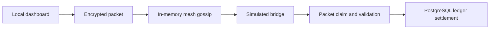

# PayMesh — Offline Payment Mesh Demo

[**Live Demo**](https://paymesh-hmen.onrender.com) · 

PayMesh demonstrates deferred payment settlement with a simulated device mesh. The dashboard creates an encrypted packet, virtual phones relay it through simulated gossip, and a virtual bridge submits it to a Spring Boot backend. PostgreSQL coordinates duplicate delivery and stores the demo ledger.

**The hosted dashboard is read-only and requires no login.** All accounts, balances, devices, and transactions are simulated. The mesh runs in memory without physical device networking. No real UPI, banking, or financial transactions occur. The first visit after idle time may take about a minute while the free Render service wakes up.

**Stack** · Java 21, Spring Boot 3.4.3, Spring Security, Spring Data JPA / Hibernate, Thymeleaf, PostgreSQL 16, Flyway, Maven, Docker, and GitHub Actions. Tests use JUnit 5 with H2 or PostgreSQL.

## Requirements

- JDK 21 or newer (the Maven build targets Java 21).
- PostgreSQL 16 recommended, running locally or at a configured URL.
- A PostgreSQL database named upimesh and credentials with permission to connect and create tables/indexes in its schema. Flyway creates/updates the schema; it does not create the PostgreSQL server or database.
- A demo username and a long, unique demo password, supplied through environment variables.
- Network access on the first Maven Wrapper/dependency download.

The normal application configuration uses PostgreSQL. The H2 configuration lives under src/test/resources/application-test.properties and is used by tests; it is not the normal application runtime database.

## Prepare PostgreSQL

Create the database using a PostgreSQL role allowed to create databases. For example, from PowerShell:

~~~powershell
psql -h localhost -U postgres -d postgres -c "CREATE DATABASE upimesh;"
~~~

If the database already exists, skip this command. The local JDBC URL defaults to jdbc:postgresql://localhost:5432/upimesh. Set a local PostgreSQL username and password in your shell; the application does not contain fallback database credentials.

### Configure and start on Windows PowerShell

~~~powershell
$env:SPRING_DATASOURCE_URL = "jdbc:postgresql://localhost:5432/upimesh"
$env:SPRING_DATASOURCE_USERNAME = "your-local-postgres-username"
$env:SPRING_DATASOURCE_PASSWORD = "your-local-password"
$env:PAYMESH_DEMO_USERNAME = "your-demo-username"
$env:PAYMESH_DEMO_PASSWORD = "your-long-random-demo-password"
.\mvnw.cmd spring-boot:run
~~~

### Configure and start on macOS/Linux

~~~bash
export SPRING_DATASOURCE_URL='jdbc:postgresql://localhost:5432/upimesh'
export SPRING_DATASOURCE_USERNAME='your-local-postgres-username'
export SPRING_DATASOURCE_PASSWORD='your-local-password'
export PAYMESH_DEMO_USERNAME='your-demo-username'
export PAYMESH_DEMO_PASSWORD='your-long-random-demo-password'
./mvnw spring-boot:run
~~~

SPRING_DATASOURCE_URL, SPRING_DATASOURCE_USERNAME, SPRING_DATASOURCE_PASSWORD, PAYMESH_DEMO_USERNAME, and PAYMESH_DEMO_PASSWORD are read by application.properties. The URL defaults to the local upimesh address, but database username/password and demo credentials are required; the app fails startup if they are missing. The server listens on port 8080 by default; SERVER_PORT can override that. .env.example is a reference template: Spring Boot does not load a .env file automatically, so set variables in your shell or IDE run configuration. Do not commit a real .env file.

Other supported environment overrides are LOGGING_LEVEL_COM_DEMO_UPIMESH, UPI_MESH_IDEMPOTENCY_TTL_SECONDS, and UPI_MESH_PACKET_MAX_AGE_SECONDS. They control application log verbosity, idempotency retention, and the maximum accepted packet age respectively. The application defaults are INFO, 86400 seconds, and 86400 seconds.

On startup, Flyway applies the existing migrations and the application seeds Alice, Bob, Carol, and Dave only if the account table is empty. Open http://localhost:8080; the browser prompts for the demo username and password before loading the dashboard. It reuses those credentials for the dashboard API calls. Stop the server with Ctrl+C.

## Dashboard demonstration

Run this interactive walkthrough on a local instance with demo writes enabled. The hosted dashboard lets visitors inspect its simulated ledger and mesh state.

Use a fresh demo database if you want the initial seeded balances. The dashboard does not need or validate a real PIN; its default 1234 is only demo input.

1. Open the dashboard and wait for the account balances and simulated devices to load.
2. Choose Alice → Bob, leave the amount at 500 and PIN at 1234, then click **Inject into Mesh**. The server-side demo helper builds a payment instruction, hashes the PIN into it, encrypts it with the server's current public key, and places a packet on phone-alice.
3. Click **Run Gossip Round**. The simulator copies packets among all virtual devices and decrements the TTL. The default topology has one internet-connected device, phone-bridge.
4. Click **Bridges Upload to Backend**. The bridge submits its packet; the backend hashes the ciphertext, claims it, decrypts it, checks instruction freshness, and atomically updates the sender/receiver balances, transaction ledger, and idempotency record. The dashboard refreshes balances and ledger every three seconds and logs the flush outcome.
5. Click **Bridges Upload to Backend** again before resetting. The bridge still holds the same packet, so the backend should report it as a duplicate and leave the balances unchanged.

Expected first outcome: SETTLED; expected second outcome: DUPLICATE_DROPPED. A payment with insufficient funds is recorded as REJECTED. Malformed or stale packets can be reported as INVALID.

### Reset behavior

**Reset Mesh + Cache** clears packets from the simulated devices and calls IdempotencyService.clear(), which deletes idempotency records. It does **not** restore account balances, delete transaction history, or reseed demo accounts. The next payment created from the dashboard gets a new packet/ciphertext and can be processed normally, subject to the sender's remaining balance. To restore the original demo data, use a fresh local demo database; do not expect this button to reset the ledger.

## How the payment path works

1. `POST /api/demo/send` constructs an encrypted packet inside the server. AES-256-GCM encrypts the instruction, and RSA-OAEP wraps the per-packet AES key. `MeshSimulatorService` relays the packet between virtual devices and decrements its time to live.
2. `POST /api/mesh/flush` sends bridge-held packets to `BridgeIngestionService` in-process. `IdempotencyService` claims the SHA-256 ciphertext hash before decryption. The database primary key arbitrates competing first claims across concurrent deliveries.
3. `SettlementService` locks the claim row and verifies its token before settling. Balance changes, the transaction row, and the terminal idempotency state commit together. A competing delivery cannot settle a completed claim, and a stale worker cannot settle after its claim token has been replaced.

The default simulator has just one bridge. Repeating flush demonstrates sequential duplicate handling. The existing tests exercise concurrent bridge delivery; the dashboard's default topology does not simulate multiple bridges racing on the same packet.

Local startup generates an ephemeral RSA key if no private key is configured. Packets encrypted with an ephemeral key cannot be decrypted after a restart. The production profile requires a persistent key.

## HTTP API

Application API paths are under `/api`. JSON request and response examples use the application models. Amounts are decimal numbers.

| Method | Path | Purpose |
|---|---|---|
| GET | / | Thymeleaf dashboard. |
| GET | /health | Public database connectivity check. |
| GET | /api/demo/dashboard | Read-only dashboard snapshot, available anonymously in public dashboard mode. |
| GET | /api/server-key | Base64 public key and crypto scheme metadata. |
| POST | /api/demo/send | Demo request { "senderVpa": "alice@demo", "receiverVpa": "bob@demo", "amount": 500, "pin": "1234", "ttl": 5, "startDevice": "phone-alice" }; returns packet ID, ciphertext preview, TTL, and injection device. ttl and startDevice are optional. |
| GET | /api/mesh/state | Device IDs, connectivity, packet counts/IDs, and idempotency-record count. |
| POST | /api/mesh/gossip | Performs one gossip round; returns transfer count and device counts. |
| POST | /api/mesh/flush | Uploads bridge-held packets; returns upload count and each bridge's outcome, reason, and transaction ID. |
| POST | /api/mesh/reset | Clears mesh packets and idempotency records only. |
| POST | /api/bridge/ingest | Ingests a MeshPacket; optional headers X-Bridge-Node-Id and X-Hop-Count. |
| GET | /api/accounts | Account records and current balances. |
| GET | /api/transactions | Most recent 20 ledger records. |

MeshPacket JSON has packetId, ttl, createdAt (epoch milliseconds), and ciphertext. An ingestion response has outcome, packetHash, reason, and transactionId; for example, a successful result has outcome SETTLED, while a repeated packet returns DUPLICATE_DROPPED.

The local dashboard uses same-origin fetch calls for these endpoints. In public dashboard mode, the browser uses `GET /api/demo/dashboard` for the synthetic read-only view. The detailed API routes require HTTP Basic authentication. Browser writes under `/api` also require a same-origin Origin header, which the browser sends automatically.

## Security and demonstration limits

The hosted dashboard, its read-only snapshot, and `/health` are available without credentials. Protected APIs and OpenAPI documentation require the shared HTTP Basic credentials configured by `PAYMESH_DEMO_USERNAME` and `PAYMESH_DEMO_PASSWORD`. Public dashboard mode blocks API writes, including payment mutations, even with valid credentials. When writes are enabled for local simulation, the API requires a same-origin request and applies its in-memory per-client rate limit.

The entered PIN is not verified and provides no authentication. There is no real bank, UPI, NPCI, account provider, phone app, Bluetooth transport, or real settlement. The mesh and accounts are simulated. Local development may use an ephemeral RSA key; the production profile requires a persistent key supplied through the environment.

## Deployment on Render

The live demo runs as a **Render Free Web Service** backed by **Render Free Postgres** in the same region. The production profile disables demo writes by default.

### Architecture

- One **Render Web Service** runs the Spring Boot JAR inside a Docker image built from the root `Dockerfile`. The image is a two-stage build: a Maven 3.9.9 + JDK 21 builder compiles the executable JAR, and an Eclipse Temurin 21 JRE runtime runs it as a non-root `paymesh` user.
- One **Render Free Postgres** database holds the demo ledger and idempotency records. Select PostgreSQL 16 to match local development and CI.
- The Docker builder uses Google Cloud Storage's Maven Central mirror for dependency prefetch and packaging, with strict checksum checks. The Maven Wrapper and GitHub Actions use their regular Maven configuration.

### Environment variables in the Render Web Service settings

| Variable | Required | Purpose |
|---|---|---|
| `SPRING_DATASOURCE_URL` | yes | Set the private JDBC URL for the Render database and require TLS with `sslmode=require`. |
| `SPRING_DATASOURCE_USERNAME` | yes | Render Postgres username. |
| `SPRING_DATASOURCE_PASSWORD` | yes | Render Postgres password. |
| `PAYMESH_DEMO_USERNAME` | yes | Shared HTTP Basic username for the dashboard and API. |
| `PAYMESH_DEMO_PASSWORD` | yes | Shared HTTP Basic password. Use a long, unique random value. |
| `PAYMESH_RSA_PRIVATE_KEY_BASE64` | yes | Persistent PKCS#8 RSA private key encoded as Base64; store only as a host secret. |
| `PAYMESH_PUBLIC_DASHBOARD` | no | Defaults to `true` in production. Enables anonymous dashboard viewing and blocks all API writes. |
| `PAYMESH_DEMO_WRITES_ENABLED` | no | Defaults to `false` in production. Interactive simulation requires public dashboard mode to be disabled. |
| `PAYMESH_API_WRITE_LIMIT_PER_MINUTE` | no | In-memory per-client write limit; defaults to 30 in production. |
| `PORT` | automatic | Render supplies the HTTP port. The production profile binds to `0.0.0.0`. |

### Render configuration

- Select the Docker runtime and the root `Dockerfile`. Render builds the image and starts it using its existing entrypoint.
- Select the Free plan and set the HTTP health check path to `/health`. The endpoint checks database connectivity.
- Create the Free Postgres database in the web service's region and use its internal hostname. See [Render Postgres connection details](https://render.com/docs/postgresql-creating-connecting#internal-connections).

### Initial migration behaviour

On first startup, Flyway applies the three versioned migrations in `src/main/resources/db/migration/`. The application initializes four demo accounts when the account table is empty. Set the demo credentials and persistent RSA key before startup.

## Tests

The repository has **48 automated tests** covering PostgreSQL migrations and settlement, concurrent duplicate delivery, crash recovery, API validation and access controls, mesh reset behavior, and health checks.

Run the full suite from the project root:

~~~powershell
.\mvnw.cmd test
~~~

On macOS/Linux use `./mvnw test`. Tests with the test profile use H2 in PostgreSQL compatibility mode. `PostgreSqlIntegrationTest` requires a dedicated PostgreSQL database named `paymesh_test` on loopback port `5433`, a role named `paymesh_test`, and the test password supplied through `PAYMESH_TEST_DATABASE_PASSWORD`. The PostgreSQL tests reset test ledger and idempotency data between cases.

## CI and public demo safeguards

`.github/workflows/ci.yml` runs `./mvnw clean verify` on Java 21 with a fresh PostgreSQL 16 service. It creates only a throwaway `paymesh_test` database and does not use `.env` files or deployment credentials. CI does not deploy.

The Docker image activates the `production` profile, runs as a non-root user, requires `PAYMESH_RSA_PRIVATE_KEY_BASE64`, and checks `/health`. Set `SPRING_DATASOURCE_URL`, `SPRING_DATASOURCE_USERNAME`, `SPRING_DATASOURCE_PASSWORD`, `PAYMESH_DEMO_USERNAME`, `PAYMESH_DEMO_PASSWORD`, and `PAYMESH_RSA_PRIVATE_KEY_BASE64` in the hosting provider's secret settings. Generate an RSA PKCS#8 private key, Base64-encode its DER bytes, and store that value as a secret; never put it in the repository or an image build argument. Production writes default to disabled. `PAYMESH_API_WRITE_LIMIT_PER_MINUTE` adjusts the in-memory per-IP limit and defaults to 30. The limiter resets on restart and is not shared across replicas.

Flyway migrations are versioned under `src/main/resources/db/migration`. The current migrations create tables/indexes and add an idempotency column; they do not drop or truncate tables. Back up persistent data before future migrations and review every migration before applying it to a hosted database. Hibernate is set to `validate`, so schema changes must go through Flyway.

### Free portfolio hosting considerations

The Free Web Service has 512 MB RAM and 0.1 CPU, spins down after 15 minutes without traffic, and uses an ephemeral filesystem. Free Postgres has 1 GB of storage, expires after 30 days, and has no managed backups. To continue the demo after expiry, the owner must manually provision a replacement and update the datasource environment variables. For a zero-cost deployment, use a Hobby workspace without a payment method. Render suspends free services or pauses builds when the applicable monthly quota runs out. See [Render free service limits](https://render.com/docs/free) and [Render billing FAQ](https://render.com/docs/faq).

For public access, use a dedicated empty database, TLS at the host, unique demo credentials and RSA key stored as host secrets, `SPRING_PROFILES_ACTIVE=production`, `PAYMESH_DEMO_WRITES_ENABLED=false`, and health check path `/health`. The app has one shared HTTP Basic identity and a process-local write limiter, so public write mode should remain disabled absent additional abuse controls.
